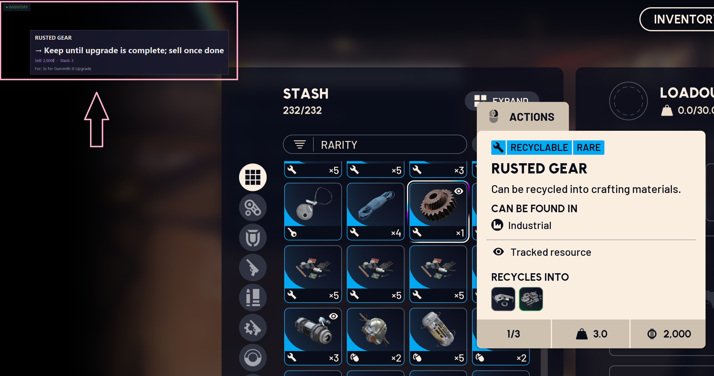
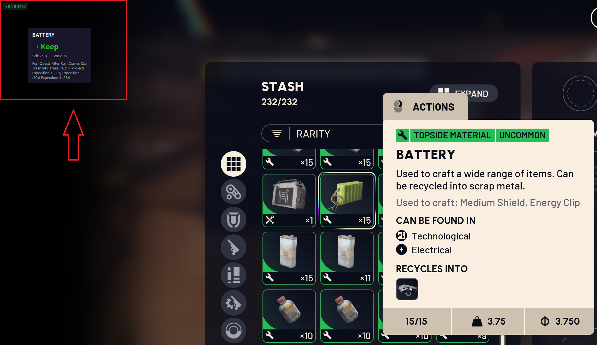
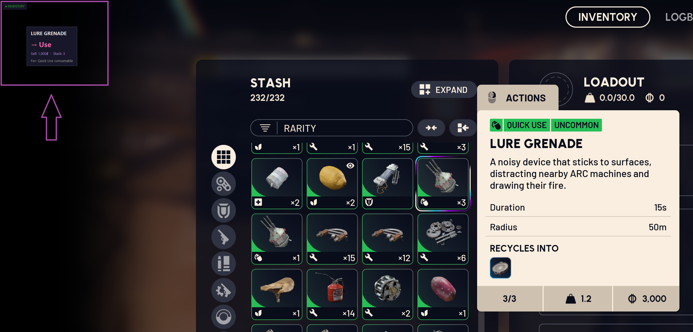

# ARLO - Arc Raiders Loot Overlay

> Fork of [Soygen/ARLO](https://github.com/Soygen/ARLO), which builds on [Pabosik/PabsArcTooltip](https://github.com/Pabosik/PabsArcTooltip). The OCR tooltip overlay idea is Pabosik’s; Soygen named and packaged ARLO. This repo ([jaredcat/arlo-plus](https://github.com/jaredcat/arlo-plus)) is the actively maintained line — 1.0.0 ships a Qt (PySide6) UI and in-game map pins.

A screen overlay tool for [Arc Raiders](https://store.steampowered.com/app/2073750/ARC_Raiders/) that detects items in your inventory and displays recommended actions (**keep**, **recycle**, **sell**) along with stack sizes, crafting details, and (in raid) sell prices. The item database auto-syncs from the [MetaForge API](https://metaforge.app/arc-raiders) on every launch.

[](static/ARLO_01.png) [](static/ARLO_02.png) [](static/ARLO_03.png)

---

## Features

- **Auto-sync on launch** - The item database updates from the MetaForge API every time you start the app (throttled to once per 24 hours). No manual steps needed.
- **In-raid sell price & stack size** - Sell price shows when the in-raid inventory trigger matches; stack size always available
- **Quest-aware recommendations** - Items needed for quests are flagged to keep, with quest names shown
- **Smart action generation** - Items are auto-categorized (keep materials, sell trinkets, recycle junk) based on API data
- **Merge mode** - New items are added without overwriting your manual action overrides
- **Hybrid catalog sync** - MetaForge for items/quests; wiki for workshop/projects/traders (see docs/ITEMS.md)
- **Player progress import** - One-click MetaForge bookmarklet filters finished quests / workshop / projects from keep recommendations
- **Qt overlay** - Tooltip, status pill, F8 map UI, and calibration run on PySide6 (replacing Tk)
- **In-game map pins** - Open the raid MAP and ARLO draws filtered Metaforge pins over the terrain (click-through); **F8** opens search/filters, **F9** filters to the last hovered item
- **Linux X11 / Wayland** - Screen capture backends for both sessions; Wayland overlays use XWayland (`xcb`)
- **GitHub Actions** - Weekly catalog sync; `main` = stable releases, `dev` = beta

Map data and basemap tiles are cached locally from Metaforge (attribution: [metaforge.app/arc-raiders](https://metaforge.app/arc-raiders)). See [docs/MAP.md](docs/MAP.md).

---

## How It Works

The tool runs two detection phases while you play:

1. **Trigger Detection** (every 500ms) - Scans for the word "INVENTORY" on screen to know when your inventory is open
2. **Tooltip Detection** (every 300ms) - When inventory is open, captures the area around your cursor, reads the item name via OCR, looks it up in the database, and shows an overlay

When the raid **MAP** is open, ARLO registers the zoomed/panned viewport to a cached Metaforge basemap and projects your search/filter pins onto the game (same capture stack as tooltips). **F8** configures search/categories without leaving the idea of playing on the in-game map.

The overlay popup displays:

```
+--------------------------------------+
|  ARC Alloy                           |
|  -> Keep                             |
|  Sell: 200   Stack: 15               |  ← Sell price only in raid
|  For: Workshop Explosives Station 1  |
+--------------------------------------+
```

- **Item name** at the top
- **Action** color-coded (green = keep, gold = sell, turquoise = recycle, pink = use)
- **Sell price** (in raid) and **stack size** on the info line
- **Details** - why you're keeping it (quests / workshop / projects) and recycle yield (`♻`), when both apply

---

## Requirements

### Pre-built Release

- Windows 10/11
- Arc Raiders running in **borderless windowed** or **windowed** mode (not exclusive fullscreen)

### Running from Source

- Windows 10/11, or Linux (X11 or Wayland)
- Python 3.11+
- [uv](https://github.com/astral-sh/uv) package manager
- [Tesseract OCR](https://github.com/UB-Mannheim/tesseract/wiki) — on Linux: `sudo apt install tesseract-ocr` / `nix-env -i tesseract`

---

## Installation

### Option 1: Pre-built Release (Recommended)

1. Download the latest **stable** release from [Releases](https://github.com/jaredcat/arlo-plus/releases) (`main`). Beta builds are marked **Pre-release** (`dev`).
2. Extract the zip to a folder of your choice
3. Run `ARLO.exe`

The release includes all dependencies, including Tesseract OCR. The item database updates automatically on launch, no more than once per 24 hours.

### Option 2: From Source

1. Clone the repository:

```
git clone https://github.com/jaredcat/arlo-plus.git
cd arlo-plus
```

2. Install dependencies:

```
uv sync --all-extras
```

3. Install [Tesseract OCR](https://github.com/UB-Mannheim/tesseract/wiki):

   - **Windows:** install to `C:\Program Files\Tesseract-OCR\` (or set `TESSERACT_PATH` in `.env`)
   - **Linux:** `sudo apt install tesseract-ocr` or `nix-env -i tesseract` (must be on `$PATH`)
   - **NixOS:** Use the provided flake (see [NixOS](#nixos) below)

4. Copy the example config:

```
copy .env.example .env
```

5. Launch the app:

```
uv run arc-helper
```

The item database updates automatically on first launch. No separate step needed.

### NixOS

The project includes a `flake.nix` so you can build the Python dependency `evdev` (required by `pynput`) with kernel headers and a C compiler, and get X11 libraries for screen capture. From the repo root:

1. Enter the dev shell (first time will create `flake.lock`):

```
nix develop
```

2. Install dependencies and run the app:

```
uv sync --all-extras
cp -n .env.example .env   # if you don't have .env yet
uv run arc-helper
```

To run without entering the shell each time: `nix develop --command bash -c 'uv run arc-helper'`.

### Linux: Wayland

On a Wayland session ARLO captures the screen through the desktop portal
(xdg-desktop-portal + PipeWire) instead of X11. Requirements:

- System packages (Arch): `sudo pacman -S --needed cairo pkgconf gcc gstreamer gst-plugins-base gst-plugin-pipewire` (Debian/Ubuntu: `sudo apt install libcairo2-dev libgirepository1.0-dev pkg-config gcc gstreamer1.0-pipewire gstreamer1.0-plugins-base`)
- `xdg-desktop-portal` plus your desktop's backend (`xdg-desktop-portal-kde`,
  `-gnome` or `-wlr`) — preinstalled on KDE/GNOME.
- Python deps: plain `uv sync` / `uv run` installs PyGObject on Linux (needed for Wayland capture).
- Hold-to-scan hotkey: reading the keyboard needs your user in the `input` group: `sudo usermod -aG input $USER` (log out and back in). Without it the
  hotkey is disabled but everything else works. The key is `HOTKEY_KEY` in
  `.env` (default `KEY_RIGHTCTRL` — hold Right Ctrl).

On first launch your desktop shows a screen-share dialog once; pick your
monitor. The approval is remembered (`.screencast_restore_token`).

Overlay and cursor positions are correctly mapped under fractional display
scaling (e.g. 4K @ 175%) — no extra configuration needed.

Notes and limitations:

- The game must run under XWayland (Proton's default) for cursor-relative
  tooltip detection; cursor position over native Wayland windows is stale.
- Tooltip capture is cursor-relative, while the game's info panel anchors to
  the hovered item, so framing isn't pixel-perfect on Wayland — it works,
  but you may see occasional "clamped" warnings in the log.
- Force a backend with `SCREEN_BACKEND=x11|wayland` in `.env`.
- Diagnostic: `uv run python -m arc_helper.screen.diag` prints the backend,
  resolution, scale and cursor, and saves a test capture to `diag_frame.png`.

---

## Item Database

### Automatic Updates

The app refreshes the catalog every launch (throttled to once per 24 hours) in **hybrid** mode. Source of truth is per field — see [docs/ITEMS.md](docs/ITEMS.md#source-of-truth):

- **MetaForge** — item catalog, prices, stacks, quests; primary recycle rows
- **Wiki** — workshop upgrade quantities, projects (incl. expiry), traders; recycle gap-fill; quest enrichment

If MetaForge is unreachable, items fall back to the [Arc Raiders Wiki](https://arcraiders.wiki/wiki/Loot). If both are down, the app continues with whatever database it already has.

Updates always run in merge mode, so any manual action overrides you've made are preserved.

### Manual Update

You can also trigger a database update from the command line:

```
uv run python update_db.py                # Hybrid update (MetaForge + wiki)
uv run python update_db.py --merge        # Keep your manual overrides
uv run python update_db.py --dry-run      # Preview changes without writing
uv run python update_db.py --source wiki  # Wiki-only (no MetaForge)
uv run python update_db.py --maps-only    # Refresh map markers (+ basemaps if MANIFEST outdated)
uv run python update_db.py --maps-only --force-map-assets  # Re-stitch all basemap PNGs
uv run python update_db.py --skip-maps    # Item/quest update without map sync
```


Or use the makefile shortcuts:

```
make update-db          # Full update
make update-db-merge    # Merge mode
make update-db-dry      # Dry run preview
```

### GitHub Actions (Optional)

The included workflow at `.github/workflows/update-db.yml` can also sync the database automatically:

- Runs weekly on Mondays at 6:00 UTC in merge mode
- Auto-commits updates under `data/` if changes are detected
- Can be triggered manually from the **Actions** tab on GitHub

No secrets or extra configuration needed.

For more details on how the updater works, CSV format, and manual database management, see [docs/ITEMS.md](docs/ITEMS.md).

---

## Player progress (MetaForge)

Import your MetaForge Raider Profile so ARLO hides keep recommendations you have already finished (quests, workshop tiers, projects, owned blueprints).

GitHub README pages cannot host `javascript:` bookmarklets, so the drag target lives on a small install page:

1. **Start ARLO** (it listens on `http://127.0.0.1:17832/` for imports).
2. Open the [install page](https://cdn.jsdelivr.net/gh/jaredcat/arlo-plus@main/docs/import-progress.html) (or `http://127.0.0.1:17832/` while ARLO is running).
3. Drag **Export to ARLO** onto your bookmarks bar (Chrome or Firefox).
4. On [MetaForge](https://metaforge.app/arc-raiders/raider-profile), Sync your profile, then click the bookmark.

ARLO writes `account-sync.json` next to the app and hot-reloads progress (no restart). On launch the status pill flashes **Progress: imported … · MetaForge synced …** for a few seconds. If ARLO is not running, the bookmark downloads `account-sync.json` instead — place it next to the app or run `uv run arc-import-progress import account-sync.json`.

Prerequisite: MetaForge must already be synced; ARLO only imports that snapshot.

---

## Building the Standalone Executable

To produce a distributable package with everything bundled:

```
uv sync --all-extras
uv run python build.py
```

Output lands in `dist/ARLO/` containing the exe, calibration tool, bundled Tesseract, config files, item database, and the updater script. Zip that folder to share with anyone - no Python install needed on their end.

See [docs/BUILD.md](docs/BUILD.md) for full build details.

---

## First Run Setup

On first launch the app detects your screen resolution and loads a matching profile if one exists:

| Resolution | Aspect Ratio        | Status       |
| ---------- | -------------------- | ------------ |
| 5120x2160  | 21:9 DQHD Ultrawide  | ✅ Configured |
| 3840x2160  | 16:9 4K UHD          | ✅ Configured |
| 3440x1440  | 21:9 Ultrawide QHD   | ✅ Configured |
| 2560x1440  | 16:9 QHD             | ✅ Configured |
| 2560x1080  | 21:9 Ultrawide FHD   | ✅ Configured |
| 1920x1080  | 16:9 Full HD         | ✅ Configured |

If your resolution isn't listed, run the [Calibration tool](docs/CALIBRATION.md):

```
uv run arc-calibrate
```

---

## Configuration

All settings live in the `.env` file. See [docs/CONFIGURATION.md](docs/CONFIGURATION.md) for details on scan regions, overlay position, display time, and debug mode.

**Debugging:** In `.env` set `DEBUG_MODE=true` for verbose logs and `SHOW_CAPTURE_AREA=true` to show the trigger and tooltip regions on screen. Restart ARLO after changing `.env`.

**Quitting:** If you started ARLO from a terminal, press **Ctrl+C**. You can also **right-click the status box** (the "Scanning…" / "ARLO Status" window) to quit, or run `pkill -f arc-helper` in a terminal.

---

## Project Structure

```
ARLO/
├── update_db.py                    # MetaForge API updater (with wiki fallback)
├── arlo.db                         # SQLite catalog (items, quests, projects, traders, maps)
├── data/                           # Readable catalog CSVs + cached map assets
│   └── maps/                       # Metaforge basemaps / markers (see docs/MAP.md)
├── pyproject.toml                  # Package config & dependencies
├── makefile                        # Convenience targets
├── build.py                        # PyInstaller build script
├── .env.example                    # Configuration template
├── .github/workflows/
│   └── update-db.yml               # Scheduled database sync
├── src/arc_helper/
│   ├── main.py                     # Main app entry point
│   ├── config.py                   # Settings & logging
│   ├── database.py                 # SQLite + CSV import + fuzzy matching
│   ├── ocr.py                      # Screen capture & Tesseract OCR
│   ├── map_*.py                    # Map ingest, sync, filter, and viewport registration
│   ├── ui/                         # Qt (PySide6) windows: overlay, status, map, calibrate
│   ├── calibrate.py                # Calibration entry (UI in ui/calibrate.py)
│   ├── resolution_profiles.py      # Resolution presets
│   ├── resolutions.json            # Pre-configured resolution profiles
│   └── screen/                     # Screen capture backends (mss / Wayland portal)
├── docs/
│   ├── ITEMS.md                    # Item database & updater docs
│   ├── MAP.md                      # In-game map pins & Metaforge cache
│   ├── CALIBRATION.md              # Calibration guide
│   ├── CONFIGURATION.md            # Settings reference
│   ├── BUILD.md                    # Build instructions
│   ├── TROUBLESHOOTING.md          # Common issues
│   └── CHANGELOG.md                # Version history
└── static/                         # Screenshots
```

---

## Contributing

### Lint, format, and types

Formatting is **Ruff** (Black-compatible; the Prettier equivalent for this repo). Type checking is **basedpyright**. Install git hooks once, then they run on every commit:

```
uv sync --all-extras
uv run pre-commit install   # format + lint + types on commit
```

Manually:

```
uv run ruff check .
uv run ruff format .
uv run basedpyright
uv run pytest
```

CI (Ruff lint/format, basedpyright, pytest) runs on every PR. Pushes to `main`/`dev` run the same checks inside the Release workflow and only publish a release if they pass. `main` is PR-only (branch protection); `dev` allows direct pushes.

### Item Database

Run `uv run python update_db.py --dry-run` to preview the API data. If you spot incorrect auto-generated actions, edit `data/items.csv` directly and use `--merge` on future updates to preserve your fixes.

### Resolution Profiles

If you calibrate for a resolution that isn't pre-configured, add it to `resolutions.json` and submit a PR.

### Bug Reports

Please include your screen resolution, debug images from the `debug/` folder (enable `DEBUG_MODE=true` in `.env`), and `arc_helper.log`. On Linux, please also note whether you're running X11 or Wayland (`echo $XDG_SESSION_TYPE`).

---

## Credits

- **[Pabosik](https://github.com/Pabosik)** / [PabsArcTooltip](https://github.com/Pabosik/PabsArcTooltip) — original OCR inventory overlay concept
- **[Soygen](https://github.com/Soygen)** / [ARLO](https://github.com/Soygen/ARLO) — ARLO naming and early packaging/catalog automation
- **[MetaForge](https://metaforge.app/arc-raiders)** - Item catalog, prices, quests, primary recycles
- **[Arc Raiders Wiki](https://arcraiders.wiki)** - Workshop/projects/traders, recycle gaps, item fallback
- **[Tesseract OCR](https://github.com/tesseract-ocr/tesseract)** - Text recognition engine
- **[PyInstaller](https://pyinstaller.org/)** - Executable packaging

---

## License

MIT License - Free to use and modify.
